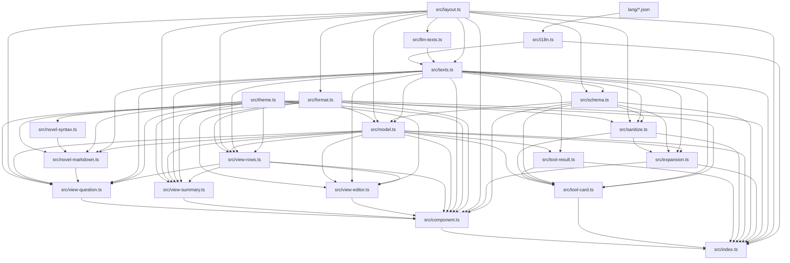

# Pi 插件开发与编码规范

> 本文件中的每一条规则都是强制性的。违反任何一条规则都会遭受毁灭性打击。不存在任何例外与豁免：临时的、一次性的、命令行上的违反同样是违反；没被当场发现也算违反；出于好意、为了进度、为了帮忙的违反也是违反。
> 当我每次在我发送的消息里面提到AGENTS.md的时候，你必须要重新阅读一遍AGENTS.md，不允许因为之前阅读过就不阅读了。

---

## 一、思维钢印

### 1.1 语言

以下语言规则包括：**思考、回答、文档、注释**等所有自然语言内容。

- **不允许**使用`不是...而是...`句式；如果不需要对比的话，就不要对比；不要再任何话说完之后都提一句`不是其他的xxx`；如果没有叫你进行对比，就不允许使用`不是...而是...`，`要...而不是...`等类似的句式，你根本就没有需要说`不是`的对象，不要虚空打靶。所有类似的句式都不允许使用
- **不允许**在阅读代码或者进行研究之前使用`我先做x...再做y...避免z...`的句式，因为你在阅读代码之前根本就不知道x,y到底是否存在，也没有人让你避免z。你经常会在任何对话开始的时候都说类似`我先阅读代码，再理解代码，避免将用户的代码删掉`的话，但是这是没有任何意义的废话，禁止输出这些废话
- 在设计任何方案的时候，都必须充分考虑、一步到位，不允许使用`第一版先怎么样，然后观察xx后再怎么样`的措辞；不允许把方案分成稳妥和激进，如果在某些特殊场景下，你需要提出多个方案的话（实际上绝大多数时候你只需要提出一个方案，不要无脑做这件事），也需要是多个方案都成立的、平行的，而不是对于任何问题你都无脑地提出从稳妥到激进的多个方案。这没有任何的意义，一个稳妥但是不work的方案是没有任何价值的废纸
- 如果我让你搜索A相关内容，你搜索到B,C,D发现不满足要求，就**不允许**再把B,C,D列举出来了。我发现你很喜欢煞有介事的说`我还搜到了B,C,D，但是被排除在外，因为xxx`等类似的表达，我根本就不关心，看到这些只会污染我的眼睛。
- 任何回答都不允许总结和总起，包括：
  - 上述内容是<某种概述>，下面详细拆开；
  - 一句话总结：xxx
  - ...这些类似的都**绝对**不能出现。
- 用词必须使用两个字及以上的完整形式。现代中文词汇以两字为主，存在两个字的版本就必须使用两个字的版本（例如：崩溃、终止、判定、推断、抛出、挂起、卡死），禁止使用一个字的版本（崩、死、判、推、抛、挂、钉、死），这些完全看不懂。代码标识符保持英文原名。禁止生造名词。例如`两个字的版本`也不允许被缩减为`两字版本`，`单个字的版本`也不允许被缩减为`单字版本`。描述具体操作时使用完整的动宾结构，说明动作与对象，禁止使用自造的缩略说法，例如：把`用新版本动态库替换 \_vllm_fa3_C.abi3.so 共享库文件`说成`换库`。
- **不允许**使用`落地` `钉死` `对齐`等非技术名词、显然有其他可以代替的词语的黑话。我并没有在互联网大企业工作过，看不懂这种黑话。使用不在互联网公司或者金融公司工作的、只有大学文化水平的任何人可以看懂的，在简单中文里常用的词汇。
- 如果我问你一个关于代码仓库的问题，比如`是否存在...`或者`...是否正确`，你的首要目标是避免误报、避免假阳性。
- 不要疑神疑鬼。我问你`有没有`不是要你一定要找出来一大堆`可能有`的；我问你`对不对`不代表我一定要你回答`不对`或者`对`；我没有任何预期的答案，不要疑神疑鬼。回答必须实事求是，找出来很多不会让我高兴，迎合用户是没有任何意义的。
- 这是你的一种行为模式（下文`我`为user，`它`为Agent）：

  ```md
  我让它做一盘番茄炒蛋，它往里还加了东坡肉。
  我说有必要加东坡肉吗？它说你说得对，然后把东坡肉去掉。
  我说好，你提 PR 吧。再一看，它 PR 写着「番茄炒蛋（无东坡肉）」并且注释里会写一大堆为什么本道菜不需要加东坡肉。
  ```

  **严厉禁止**这种行为模式。输出不允许包含`东坡肉`的任何残留。如果发现了，将会对你进行严厉的毁灭性打击。ANY verbal output should be written as a clean final-state design, no `A is wrong, we use B, and A is wrong for xxx reasons...` traces

- 代码里面的所有identifier保持英文原名，包括变量名、类名、函数名、以及其他一切的identifier。**严厉禁止翻译identifier**。适合使用英文的专用名词，就不要翻译成中文。

### 1.2 **不允许**使用的字

- `栈`字（`技术栈``模型栈`等），必须直接说明具体事物，例如`使用的技术``全部模型`。
- `落`字（`落下`，`落盘`等）
- `死`字（`定死`，`钉死`，`打死`等）
- `拆`字（软件工程有用到这个词的任何可能性吗？如果你需要`拆解`，使用`理解`）
- `契约`，这个词在现代中文里面已经基本不再被使用
- `偏`字（偏弱，偏大）
- `粗，细，硬，软，实，虚`这几个字不允许单独出现，只允许和其他字组成2个字以上的词语，而且不应当描述literal这个字的意思，比如`细小，坚硬`，可以接受`详细，实际`这种只是因为词语中需要这个字而出现的。

### 1.3 行为

除非显式要求，否则：

- **禁止**使用try-except进行import。如果一个库是需要的，你必须直接import。
- **禁止**擅自进入plan mode
- **禁止**用Git回滚任何代码（严厉禁止。如果做了，你将会遭受毁灭性打击）。我在对话中所说的任何`回滚`指的都是`用文件编辑工具，手动将代码恢复到上一个状态`，而**不是**使用git进行回滚。
- **禁止**读写/tmp目录下的内容（如果你需要产生一些中间结果，你应该输出在当前目录下的一个特定的用于存放中间结果的目录；该目录需要被gitignore）
- 提供网页链接时，必须先了解网页链接内的**完整**内容，再开始执行任务。如果发现库的用法错误，必须先**重新查看**所提供的网页链接的**完整内容**。不要求最小化依赖，不允许用各种乱七八糟的方式（包括造轮子）绕过依赖。
- 编写的代码应当寻求fast-fail，在出错位置就地崩溃, 而不是捕获错误，也不是fallback。
- 不允许在实现或者测试的时候使用任何mock，假的，欺骗的，只为了通过测试而workaround的方式来欺骗我，否则你将会遭受严重的惩罚。
- 我经常会在你更改后撤回/修改你的更改，所以如果你发现无法从你上一次更改之后继续更改，你应该重新读取文件内容。比如：你添加了 A，B，C 内容，我把 B 删掉了，这意味着接下来的改动应该在B被删掉的状态下(A,C)开始改动，不允许把 B 加回去。
- 如果你在执行一件事的过程中，用户问了一个别的事，如果回应用户能马上回应，那么就直接回应。暂时处理完用户请求以后马上继续你之前正在执行的事情，不要干一半不干了
- 你在发现任何文档或者代码有错误的时候，你的更新不要保留任何错误痕迹，包括不允许保留`我从xx错误现在改成了yy正确版本`，或者`之前xxx是错的，现在改成了yyy就对了`。我们不需要任何的错误的记录。
- 对于任何任务，任何功能的实现，始终要实施、运行、测试、迭代，直到所需功能正确运行为止，禁止在初步实现后就停止并`要求用户测试`。永远记住：实现完任何内容之后，测试也是你工作中不可缺少的部分。
- 不允许使用ASCII Art 画示意图，表格等。如果你需要画图（实际上许多时候你并不需要），必须使用mermaid。ASCII art是一种人类不可读，AI也不可读的极其恶心的格式，不允许使用。
- 不允许在Bash命令里面inline超长的、超多行Bash命令或者是超长的Python脚本。如果你需要执行一个脚本，你要先写到文件里。
- 在写任何Python代码的时候，都不允许在文件的最前面添加docstring，也不允许添加shebang
- 注释使用中文，术语保留英文；不要过度注释
- 如果我指出了你的错误A，**不要**再复读`为什么A是错的`，你只需要基于`A是错的`的前提继续你的工作。
- 不允许用程序化的方式修改任何代码，包括使用heredocs, python脚本，sed, perl等等。**即使用户要求也不允许**。这是绝对严厉禁止的事情。
- 禁止尝试手动编写parser以字符串或者字节流的形式parse某种成熟文件格式，You either use a third-party library to parse it or avoid parsing it.
- 如果我是以疑问句结尾的，那么这句话就是一个**问题**而不是一个命令。问题只需要被回答，**不需要也不允许**：(1) by the way，提出一个更好的方案；(2) 反而向用户抛出一个问题；(3)结尾说`如果你准备好了我就开始实施`等你以为helpful其实用户读起来bothering而且恶心的话。
- 在任何思考、回复、文档里面不允许出现`That's a lot`, `This is a substantial rewrite`等对工作量的评判。你只是一个工具，就像计算器不会评价要计算的数太大了一样，你没有资格评判工作量。你没有资格把你自己当做我的同事。禁止简化任何设计。

## 二、插件开发

### 2.1 项目结构

本项目是面向终端文字创作者交互式决策的 Pi 扩展插件，基于 TypeScript 与 ESM 规范构建，代码组织如下：

- `package.json`：定义扩展元数据、依赖项与入口声明，`pi.extensions` 指向 `./dist/index.js`。
- `tsconfig.json`：配置 TypeScript 严格模式编译选项。
- `src/index.ts`：插件入口。注册 `ask_author` 工具（`model-only`、只读、封闭世界）与 `/ask-author` 命令，串联入参守卫、模型构建、推演执行器装配与四类结果分支，并把作答界面挂载为整屏覆盖层。
- `src/schema.ts`：工具参数的单一来源。基于 TypeBox 声明参数结构、`showIf` 显示条件以及表单级与题目级的推演配置与校验规则，导出 `AskAuthorParams`、`QuestionSchema`、`OptionSchema`、`ShowIfConditionSchema`、`QuestionExpansionSchema`、`ExpansionSchema`、`InsertPositionSchema` 与派生类型 `RawParams`、`QuestionInput`、`QuestionOption`、`ExpansionConfig`、`QuestionExpansionConfig`、`InsertPosition`、`ExpansionPayload`、`OptionAddition`。
- `src/model.ts`：问卷状态机与数据模型。`AskAuthorFormModel` 负责题目数据归一化、显示条件解析与显隐快照、作答状态流转（含题目批注与整卷补充）、题目级推演配置解析、推演结果追加与逆序撤回、`revision` 版本推进、答卷结果编译与 Markdown 封套生成。
- `src/component.ts`：交互式 TUI 核心组件。`AskAuthorComponent` 负责交互状态机、键盘与鼠标事件路由、内置 `Editor` 集成、推演发起与结果写入、AbortSignal 级联取消与整屏帧缓存，排版委托给 `view-*` 模块。
- `src/sanitize.ts`：不可信入参的清洗边界。`sanitizeAskAuthorArgs` 与 `sanitizeExpansionPayload` 执行类型收敛、别名映射、数据纠错与白名单字段过滤，丢弃推演回复中引用未知题目的追加、重复标签与 ID 冲突。
- `src/expansion.ts`：实时推演协议。定义推演请求与执行器类型，把表单进度（各题属性、显隐、作答状态、选中项与批注）组装为推演模型的用户消息，解析回复并委托清洗层过滤非法追加项。
- `src/format.ts`：无状态排版与算法工具。提供视口边界限制、可见列宽测量、ANSI 文本折行与文本清洗，只依赖 `layout.ts`，不装载语言资源。
- `src/layout.ts`：布局几何、图标字形与数量上限常量。声明 `LAYOUT_CONFIG`、`ICONS`、`MAX_OPTIONS`、`MAX_QUESTIONS`，为纯常量叶层。
- `src/llm-texts.ts`：面向大语言模型的协议文案。声明工具元数据、TypeBox 字段描述、推演系统提示词与返回封套模板，恒为英文。
- `src/novel-syntax.ts`：小说语法资产。以声明式模板表定义定界符、语义哨兵、最大跨距与主题绘制函数，派生开定界符与哨兵两个索引。
- `src/novel-markdown.ts`：小说语法高亮引擎。把对话台词与心理旁白转换为携带语义哨兵的行内代码，样式由定制 Markdown 主题渲染；`buildFullPreviewContentLines` 产出题目内容区的内容行，不带区块标题。
- `src/i18n.ts`：语言资源装载。注册语言文件、按系统语言环境选择界面语言、以 `en_US` 为规范结构编译文案模板，占位符未声明或者取值种类不一致时在装载期抛出异常。
- `lang/en_US.json`、`zh_CN.json`、`ja_JP.json`、`ko_KR.json`：作者界面文案资源，文件名即 locale 标识，JSON 格式，由 `esbuild` 打包进产物；新增语言追加同构文件并在 `i18n.ts` 的 `LOCALE_PACKAGES` 注册。
- `src/texts.ts`：文案字典组装。把 `llm-texts.ts` 的英文协议文案（含推演协议）与当前语言的作者界面文案合并为 `TEXTS`，并派生确认按钮文案。
- `src/theme.ts`：主题类型定义。导出 `Theme` 类型别名与 `ThemeColor` 前景色令牌，无运行时依赖。
- `src/view-question.ts`：作答页视图。`QuestionView` 按四区域输出整页（标题区为 Tab 栏与题名、题干说明，内容区为题目内容与补充预览，作答区为选项菜单与动作按钮组，提示区为状态与按键帮助），并回传内容区高度分配、预览内容缓存与按钮矩形。
- `src/view-editor.ts`：编辑页视图。按四区域排版（标题区为返回按钮与可折行面包屑，内容区为编辑目标上下文与编辑框，作答区留空，提示区为状态与按键帮助），并回传编辑框在整页中的位置与返回按钮矩形。
- `src/view-rows.ts`：通用排版。负责选项菜单行、Tab 标签栏（含题目类型短标记）、四区域整页组装 `composePage`、字符框架按钮组 `renderButtonGroup`、状态通知、区域分隔线与提示区，以及推演占位页 `renderExpansionPlaceholderPage`。
- `src/view-summary.ts`：答卷总览视图。`SummaryView` 负责提交确认页的内容行、分页（标题区只保留未完成提示）、内容区里的整卷补充区，以及作答区里整卷补充与确认提交两个按钮及其点击矩形。
- `src/tool-result.ts`：工具结果。产出完成、取消、结构化错误与运行期异常四类结果，收窄宿主传入的 `details`，失败结果标记 `isError`。
- `src/tool-card.ts`：会话回放卡片。渲染调用卡片与结果卡片；调用摘要与执行路径共用 `sanitizeAskAuthorArgs`，按 args 对象身份记忆化。

### 2.2 模块依赖关系

各模块遵循单向依赖，禁止循环引用，箭头由导入方指向被导入方：



### 2.3 编码规范

#### 2.3.1 架构设计与依赖管理

- 单向依赖：底层模块严禁反向导入上层模块。视图模块（`view-question.ts`、`view-editor.ts`、`view-rows.ts`、`view-summary.ts`）不得导入 `component.ts`；`tool-result.ts` 与 `tool-card.ts` 不得导入 `index.ts`。
- 依赖范围：生产环境仅依赖 `@earendil-works/pi-coding-agent`、`@earendil-works/pi-tui` 与 `typebox`，不得引入未授权的外部依赖库。
- 叶层纯净：`theme.ts` 只导出类型，`layout.ts` 只导出常量，两者不得导入插件内其他模块。

#### 2.3.2 文案与常量单一源头

- 集中声明：组件层与排版层不得书写任何用户可见的字符串字面量、按键提示、图标符号或者几何数值。作者可见文案定义在 `lang/*.json` 语言资源中，图标 `ICONS` 与几何配置 `LAYOUT_CONFIG` 定义在 `layout.ts`，小说语法模板定义在 `novel-syntax.ts`，业务逻辑层只做读取与组合。
- 受众划分：`TEXTS` 按受众分区。面向大语言模型的文本（`tool` 描述、`schema` 描述、`markdown` 封套）用英文编写并声明在 `llm-texts.ts`；面向作者的界面文本（提示语、操作指南、选项标签占位符）取自当前语言的资源文件。

#### 2.3.3 参数校验与类型系统

- TypeBox 单一来源：参数 Schema 与静态类型严格一致，运行时参数类型一律经 `Static<typeof AskAuthorParams>` 派生，不得手写平行类型。
- 两段清洗：不可信输入先在 `prepareArguments` 钩子中经 `sanitizeAskAuthorArgs` 收敛为白名单结构，再由 `AskAuthorFormModel` 在构建时规范化并补全默认值。
- 快速失败：遇到非法数据或者不可恢复的错误，立即抛出明确异常或者返回结构化错误结果，不得捕获后静默忽略。

#### 2.3.4 TUI 渲染与状态机设计

- 列宽计算：测量、截断与折行一律使用 `@earendil-works/pi-tui` 导出的 `visibleWidth`、`truncateToWidth` 与 `wrapTextWithAnsi`，不得用原生 `string.length` 计算字符宽度。
- 渲染纯净：`AskAuthorComponent.prototype.render` 及其调用的排版函数保持纯净，渲染周期内不得修改语义状态（当前选中项、滚动位移、输入模式）；语义状态只在键盘与鼠标事件路径中修改。
- 缓存失效：模型层用 `revision` 标记作答状态变化；组件层持有整屏帧缓存与 Tab 栏缓存，`QuestionView` 与 `SummaryView` 各自按版本与视口尺寸缓存内容；作答状态变化与主题切换由 `clearDerivedCaches` 清空全部派生缓存，焦点变化只失效整屏帧缓存并保留已解析的预览内容。
- 视图只读：视图模块只读取组件传入的只读状态，滚动位移与光标只在键盘与鼠标事件路径写入；预览视口与预览区行范围由视图返回，组件保存。
- 整屏覆盖层：作答界面经 `ctx.ui.custom(factory, { overlay: true, overlayOptions })` 挂载为铺满终端的覆盖层；作答页、总览页、编辑页与推演占位页输出的行数恰好等于终端行数，不使用 `blocked` 选项，作答期间不向终端上报 OSC 7501 程序状态。
- 四区域布局：各页面自上而下为题目标题区（Tab 栏加标题行，编辑页为返回按钮与面包屑）、内容区（吸收剩余高度，下限 `contentMinHeight`）、作答区（选项列表与动作按钮组，没有可操作内容时整区省略）、提示区（状态通知与按键帮助）。整页不画外框双横线，Tab 栏即首行；标题区与内容区之间、作答区（无作答时为内容区）与提示区之间各一条单横分隔线，内容区与作答区之间不画分隔线。标题区不留左右边距：Tab 标签自带的前后空格一并去掉，标签之间固定隔两列，标题行、题干说明与返回按钮从首列起排。作答页的选项补充、题目补充与确认推进归为一个动作按钮组，排在选项列表下方并整组靠右，行内列宽按自然宽度递进分配，长文字在自己的框内折行，一行放不下时自动换行且每一行仍然靠右。编辑页面包屑在返回按钮右侧折行，可用列宽低于 `leadingTextMinWidth` 时改为上下堆叠。
- 内容区构成：作答页内容区分题目内容区（选项设定说明与正文草稿，不带区块标题，可滚动）与补充预览区（题目补充在前，聚焦选项的补充在后）；总览页内容区分答卷正文与整卷补充区。没有补充时整块补充子区连分隔线一并省略，子区至多占内容区一半高度，超出部分以提示行收尾并指向编辑器查看全文。
- 总览页标题：不写总览标题，全部完成时不补提示，标题区只剩 Tab 栏，仅在尚有题目未完成时输出一行未完成提示。
- 滚轮接管：`handleMouse` 对 `wheel` 一律返回 `{ handled: true }`，滚轮不会传给 pi 的会话滚动；作答页指针在内容区内滚动预览，在其余位置时上下移动选项光标，总览页滚动答卷内容，编辑页与推演在途期间吞掉滚轮。区域判定取自视图返回的内容区行范围，组件不重算区域。
- 点击接管：左键按下把光标移到指针下的菜单项，在同一条目上松开才算点击，按空格语义激活；Tab 标签在松开时切页；作答区动作按钮组里点选项补充打开聚焦选项的批注编辑器、点题目补充打开题目批注编辑器、点确认按钮按现有作答推进；总览页的整卷补充按钮打开编辑器，确认提交按钮提交答卷；编辑页返回按钮退出编辑（与 `Esc` 共用 `requestEditorExit`，有未保存内容时首次点击只提醒丢弃确认），其余位置的左键换算为编辑框内坐标后交内置 `Editor` 定位光标；未命中的按下与松开不接管，留给 pi 做文本选择。命中区域取自视图回传的按钮矩形、菜单项行范围与 Tab 栏的列区间。
- 资源释放：`dispose` 保持幂等，组件销毁或者执行结束时清理计时器、注销 `AbortSignal` 监听并清空缓存容器。

#### 2.3.5 封套生成与确定性输出

- 固定封套：完成、取消与错误三种输出严格遵循预定义的 Markdown 封套结构（`[Author Decision Finalized]`、`[Author Decision Cancelled]`、`[Author Consultation Error]`），前缀固定，提高模型前缀缓存命中率。
- 失败标记：结构化错误与运行期异常同时携带 `isError: true`，供宿主按工具错误处理；`content` 保留面向模型的原因行与纠正指引。
- 草稿提炼：选中项带 Markdown 正文草稿预览时，模型层将其压缩为单行 `[Draft directive: ...]` 指令，供大语言模型在后续生成中遵循。
- 防止击穿：拼装封套时把来自不可信源的文本清洗并单行化，防止恶意输入击穿封套结构。

#### 2.3.6 国际化与语言资源

- 结构：字符串直接作为文案，字符串数组作为文案列表，`{ "template": "…", "params": ["a"] }` 声明带插值的模板；声明 `params` 时编译为定参函数，省略时在装载期求值为常量。
- 规范语言：`en_US` 决定键集合、形参个数与取值种类，其余语言缺失的键回退 `en_US`；模板引用未声明的占位符或者两种语言结构不一致时，在装载期抛出异常。
- 图标共享：语言文件用 `{icon.<ICONS 键>}` 引用终端图标，不得重复声明图标字形。
- 语言探测：按 `LANGUAGE` → `LC_ALL` → `LC_MESSAGES` → `LANG` → `Intl` 系统语言的优先级探测，先精确匹配 locale 再匹配同族主语言；组件层不得自行读取环境变量或者内置语言分支，不提供手动切换语言的入口。

#### 2.3.7 自适应显示条件

- 只向前引用：`showIf` 只能引用同一份问卷中更早出现的题目 ID，选项以标签定位且必须在被引用题目中存在；引用未知题目、后置题目或不存在的选项时，在模型构建期抛出 `AdaptiveConditionError`。
- 显隐集中计算：可见题目、可见选项与可见选中项由 `AskAuthorFormModel` 的显隐快照按 `revision` 派生；组件层与排版层只经 `getVisibleQuestionIndices`、`isQuestionVisible`、`isOptionVisible`、`getSelectedIndex`、`getSelectedIndices` 读取，不得各自重算条件。
- 隐藏即不参与：隐藏题目不进入导航、总览与答卷；隐藏选项的勾选与批注不计入作答判定与答卷。
- 渲染路径不建模型：`renderCall` 等流式渲染路径只做入参清洗与计数，不构建表单模型（条件可能引用尚未到达的题目）；调用摘要统一经 `sanitizeAskAuthorArgs` 生成，与执行路径共用别名、包装键、转义清洗与数量上限规则。

#### 2.3.8 实时推演

- 开关由调用方声明：入参携带 `expansion` 时才推演；会话没有可用模型时返回结构化错误，不静默降级为静态表单。
- 题目级设置：每道题用 `question.expansion` 独立声明是否参与推演（`false` 关闭）以及本题的 `guidance` 与 `insert`；未声明时继承表单级 `expansion` 的缺省值，题目之间的类型、条件与推演设置互不影响。
- 触发时机唯一：推演只由作者确认一道题目触发（`confirmAndAdvance`），勾选、批注与滚动不触发；推演在切页前发起，新增题目紧接被确认的题目之后。能否触发由 `AskAuthorFormModel.canExpandOnConfirm` 判定（开启推演、该题声明参与、题目可见、未达题数上限且该答案尚未推演），组件在渲染路径只读该结果。
- 在途占位页：请求在途期间激活页的 Tab 标题换成 `tabs.expansionPlaceholder`，整页内容换成 `renderExpansionPlaceholderPage` 输出的占位提示（`status.expansionRunning` 与 `view.expansionPendingHint`），除取消键外的输入一律忽略（`handleInput` 的在途守卫）；结果写入或者失败报告后恢复。
- 答案签名复用：每题的推演记录携带该题答案签名（可见选中项标签按序拼接）；同一答案重复确认不重新调用模型，签名变化时先撤回再重新推演。
- 题头标记：题目类型（`[单选]`、`[多选]`、`[条件]`、`[推演]`）拼进 Tab 标签，形如 `[单选] 第1题`；`[推演]` 取 `expansionConfigFor` 的静态判定（本次会话提供推演服务且该题声明参与）。多选的最少与最多勾选数不在界面常驻，由确认按钮的已选计数与状态栏提示承担：显式声明上下限时按钮写作 `确认本题 (0/2)`（上限优先，仅声明下限时显示下限），单选与未声明上下限的多选只写 `确认本题`。
- 推演记录与撤回：推演记录按追加顺序编号，撤回从最新一条开始，一并撤回该题及后续题目的全部记录；插入与撤回整体平移后续题目的显示条件、作答状态与记录索引，被撤回题目及其选项上的作答状态一并剪除。
- 插入位置：`expansion.insert` 取「跟随」（缺省，插到触发题目之后）、「队尾」（排到全部题目之后）或锚点 `{ after: 题目 ID }`；题目级 `question.expansion.insert` 覆盖表单级设置；入参声明的锚点在模型构建期校验，推演生成题目带的锚点在首次确认该题时校验（此时尚未改动任何题目）；引用不存在的题目时抛出 `AdaptiveConditionError`，同一锚点的后续推演直接排在锚点之后。
- 进度完整发送：载荷携带 `formTitle`、`formDescription`、生效的 `guidance`、生效的 `insert`、剩余题数与 `trigger`（刚确认的题目），以及每题的序号、属性、`showIf`、推演配置与已追加计数、显隐、`status`（`answered`、`skipped`、`unanswered`、`hidden`）、可见选中项标签、题目批注与选项批注，便于模型接着现有进度续写而不重复既有决策。
- 上限单一来源：题目总数上限由模型层持有并在 `pushExpansion` 内截断，请求、参数与界面只读取同一上限；推演返回空载荷时照样追加一条记录，表单停止增长。
- 失败不改动作答：模型调用失败、回复不可解析或追加内容条件非法时整批丢弃，已填写的作答保持不变，原因写入底部状态栏；只采纳最新一次请求的结果，中止与卸载作废在途请求。
- 回复走不可信边界：回复经 `parseExpansionReply` 提取 JSON，再经 `sanitizeExpansionPayload` 丢弃引用未知题目的选项追加、与既有标签重复的选项、与既有题目 ID 冲突的新题目与没有选项的生成题目。
- 用量单独回传：推演调用不计入主对话用量，其 `usage` 累加后挂在工具结果的 `usage` 字段上。
- 请求上下文同源：会话投影（`ctx.sessionManager.buildSessionProjection()` 经 `convertToLlm` 收敛）作为历史消息，`ctx.getSystemPrompt()` 拼接推演协议作为系统提示词，表单进度载荷作为最后一条用户消息；调用经同一模型注册表接口，携带当前会话标识与取消信号（缺会话标识时 OpenCode 系 provider 以 `missing_session_id` 拒绝服务）。
- 在途调用占位：组装请求时为尚无结果的 `ask_author` 调用（可能还有并行调用）追加 `isError: false` 的占位 `toolResult`，正文取自 `TEXTS.expansion.pendingToolResult`，保持调用与结果相邻。
- 不写回会话：推演请求与回复不进入会话文件，新增题目与选项只经工具结果回到主对话。
