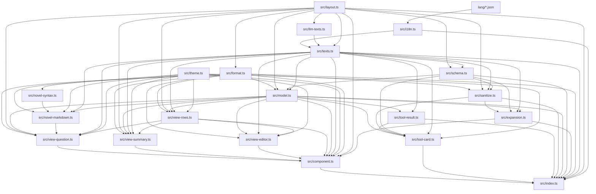

# Pi 插件开发与编码规范

> 本文件中的每一条规则都是强制性的。违反任何一条规则都会遭受毁灭性打击。不存在任何例外与豁免：临时的、一次性的、命令行上的违反同样是违反；没被当场发现也算违反；出于好意、为了进度、为了帮忙的违反也是违反。
> 当我每次在我发送的消息里面提到AGENTS.md的时候，你必须要重新阅读一遍AGENTS.md，不允许因为之前阅读过就不阅读了。

---

## 一、思维钢印

### 1.1 语言

以下语言规则包括：**思考、回答、文档、注释**等所有自然语言内容。

- **不允许**使用`不是...而是...`句式；如果不需要对比的话，就不要对比；不要再任何话说完之后都提一句`不是其他的xxx`；如果没有叫你进行对比，就不允许使用`不是...而是...`，`要...而不是...`等类似的句式，你根本就没有需要说`不是`的对象，不要虚空打靶。所有类似的句式都不允许使用
- **不允许**在阅读代码或者进行研究之前使用`我先做x...再做y...避免z...`的句式，因为你在阅读代码之前根本就不知道x,y到底是否存在，也没有人让你避免z。你经常会在任何对话开始的时候都说类似`我先阅读代码，再理解代码，避免将用户的代码删掉`的话，但是这是没有任何意义的废话，禁止输出这些废话
- 在设计任何方案的时候，都必须充分考虑、一步到位，不允许使用`第一版先怎么样，然后观察xx后再怎么样`的措辞；不允许把方案分成稳妥和激进，如果在某些特殊场景下，你需要提出多个方案的话（实际上绝大多数时候你只需要提出一个方案，不要无脑做这件事），也需要是多个方案都成立的、平行的，而不是对于任何问题你都无脑地提出从稳妥到激进的多个方案。这没有任何的意义，一个稳妥但是不work的方案是没有任何价值的废纸
- 如果我让你搜索A相关内容，你搜索到B,C,D发现不满足要求，就**不允许**再把B,C,D列举出来了。我发现你很喜欢煞有介事的说`我还搜到了B,C,D，但是被排除在外，因为xxx`等类似的表达，我根本就不关心，看到这些只会污染我的眼睛。
- 任何回答都不允许总结和总起，包括：
  - 上述内容是<某种概述>，下面详细拆开；
  - 一句话总结：xxx
  - ...这些类似的都**绝对**不能出现。
- 用词必须使用两个字及以上的完整形式。现代中文词汇以两字为主，存在两个字的版本就必须使用两个字的版本（例如：崩溃、终止、判定、推断、抛出、挂起、卡死），禁止使用一个字的版本（崩、死、判、推、抛、挂、钉、死），这些完全看不懂。代码标识符保持英文原名。禁止生造名词。例如`两个字的版本`也不允许被缩减为`两字版本`，`单个字的版本`也不允许被缩减为`单字版本`。描述具体操作时使用完整的动宾结构，说明动作与对象，禁止使用自造的缩略说法，例如：把`用新版本动态库替换 \_vllm_fa3_C.abi3.so 共享库文件`说成`换库`。
- **不允许**使用`落地` `钉死` `对齐`等非技术名词、显然有其他可以代替的词语的黑话。我并没有在互联网大企业工作过，看不懂这种黑话。使用不在互联网公司或者金融公司工作的、只有大学文化水平的任何人可以看懂的，在简单中文里常用的词汇。
- 如果我问你一个关于代码仓库的问题，比如`是否存在...`或者`...是否正确`，你的首要目标是避免误报、避免假阳性。
- 不要疑神疑鬼。我问你`有没有`不是要你一定要找出来一大堆`可能有`的；我问你`对不对`不代表我一定要你回答`不对`或者`对`；我没有任何预期的答案，不要疑神疑鬼。回答必须实事求是，找出来很多不会让我高兴，迎合用户是没有任何意义的。
- 这是你的一种行为模式（下文`我`为user，`它`为Agent）：

  ```md
  我让它做一盘番茄炒蛋，它往里还加了东坡肉。
  我说有必要加东坡肉吗？它说你说得对，然后把东坡肉去掉。
  我说好，你提 PR 吧。再一看，它 PR 写着「番茄炒蛋（无东坡肉）」并且注释里会写一大堆为什么本道菜不需要加东坡肉。
  ```

  **严厉禁止**这种行为模式。输出不允许包含`东坡肉`的任何残留。如果发现了，将会对你进行严厉的毁灭性打击。ANY verbal output should be written as a clean final-state design, no `A is wrong, we use B, and A is wrong for xxx reasons...` traces

- 代码里面的所有identifier保持英文原名，包括变量名、类名、函数名、以及其他一切的identifier。**严厉禁止翻译identifier**。适合使用英文的专用名词，就不要翻译成中文。

### 1.2 **不允许**使用的字

- `栈`字（`技术栈``模型栈`等），必须直接说明具体事物，例如`使用的技术``全部模型`。
- `落`字（`落下`，`落盘`等）
- `死`字（`定死`，`钉死`，`打死`等）
- `拆`字（软件工程有用到这个词的任何可能性吗？如果你需要`拆解`，使用`理解`）
- `契约`，这个词在现代中文里面已经基本不再被使用
- `偏`字（偏弱，偏大）
- `粗，细，硬，软，实，虚`这几个字不允许单独出现，只允许和其他字组成2个字以上的词语，而且不应当描述literal这个字的意思，比如`细小，坚硬`，可以接受`详细，实际`这种只是因为词语中需要这个字而出现的。

### 1.3 行为

除非显式要求，否则：

- **禁止**使用try-except进行import。如果一个库是需要的，你必须直接import。
- **禁止**擅自进入plan mode
- **禁止**用Git回滚任何代码（严厉禁止。如果做了，你将会遭受毁灭性打击）。我在对话中所说的任何`回滚`指的都是`用文件编辑工具，手动将代码恢复到上一个状态`，而**不是**使用git进行回滚。
- **禁止**读写/tmp目录下的内容（如果你需要产生一些中间结果，你应该输出在当前目录下的一个特定的用于存放中间结果的目录；该目录需要被gitignore）
- 提供网页链接时，必须先了解网页链接内的**完整**内容，再开始执行任务。如果发现库的用法错误，必须先**重新查看**所提供的网页链接的**完整内容**。不要求最小化依赖，不允许用各种乱七八糟的方式（包括造轮子）绕过依赖。
- 编写的代码应当寻求fast-fail，在出错位置就地崩溃, 而不是捕获错误，也不是fallback。
- 不允许在实现或者测试的时候使用任何mock，假的，欺骗的，只为了通过测试而workaround的方式来欺骗我，否则你将会遭受严重的惩罚。
- 我经常会在你更改后撤回/修改你的更改，所以如果你发现无法从你上一次更改之后继续更改，你应该重新读取文件内容。比如：你添加了 A，B，C 内容，我把 B 删掉了，这意味着接下来的改动应该在B被删掉的状态下(A,C)开始改动，不允许把 B 加回去。
- 如果你在执行一件事的过程中，用户问了一个别的事，如果回应用户能马上回应，那么就直接回应。暂时处理完用户请求以后马上继续你之前正在执行的事情，不要干一半不干了
- 你在发现任何文档或者代码有错误的时候，你的更新不要保留任何错误痕迹，包括不允许保留`我从xx错误现在改成了yy正确版本`，或者`之前xxx是错的，现在改成了yyy就对了`。我们不需要任何的错误的记录。
- 对于任何任务，任何功能的实现，始终要实施、运行、测试、迭代，直到所需功能正确运行为止，禁止在初步实现后就停止并`要求用户测试`。永远记住：实现完任何内容之后，测试也是你工作中不可缺少的部分。
- 不允许使用ASCII Art 画示意图，表格等。如果你需要画图（实际上许多时候你并不需要），必须使用mermaid。ASCII art是一种人类不可读，AI也不可读的极其恶心的格式，不允许使用。
- 不允许在Bash命令里面inline超长的、超多行Bash命令或者是超长的Python脚本。如果你需要执行一个脚本，你要先写到文件里。
- 在写任何Python代码的时候，都不允许在文件的最前面添加docstring，也不允许添加shebang
- 注释使用中文，术语保留英文；不要过度注释
- 如果我指出了你的错误A，**不要**再复读`为什么A是错的`，你只需要基于`A是错的`的前提继续你的工作。
- 不允许用程序化的方式修改任何代码，包括使用heredocs, python脚本，sed, perl等等。**即使用户要求也不允许**。这是绝对严厉禁止的事情。
- 禁止尝试手动编写parser以字符串或者字节流的形式parse某种成熟文件格式，You either use a third-party library to parse it or avoid parsing it.
- 如果我是以疑问句结尾的，那么这句话就是一个**问题**而不是一个命令。问题只需要被回答，**不需要也不允许**：(1) by the way，提出一个更好的方案；(2) 反而向用户抛出一个问题；(3)结尾说`如果你准备好了我就开始实施`等你以为helpful其实用户读起来bothering而且恶心的话。
- 在任何思考、回复、文档里面不允许出现`That's a lot`, `This is a substantial rewrite`等对工作量的评判。你只是一个工具，就像计算器不会评价要计算的数太大了一样，你没有资格评判工作量。你没有资格把你自己当做我的同事。禁止简化任何设计。

## 二、插件开发

### 2.1 项目结构

本项目属于面向终端文字创作者交互式决策的 Pi 扩展插件，基于 TypeScript 与 ESM 规范构建。代码组织如下：

- `package.json`：定义扩展元数据、依赖项与入口声明，通过 `pi.extensions` 字段导出 `./dist/index.js`。
- `tsconfig.json`：配置 TypeScript 严格模式编译选项。
- `src/index.ts`：插件主入口模块。注册 `ask_author` 工具与 `/ask-author` 辅助命令，编排工具执行过程中的守卫、模型构建、实时推演的模型调用与四类结果分支；工具声明为 `model-only` 并标注只读、封闭世界。
- `src/schema.ts`：工具参数的单一源头。基于 TypeBox 声明参数结构、`showIf` 显示条件、表单级与题目级实时推演配置与校验规则，导出 `AskAuthorParams`、`QuestionSchema`、`OptionSchema`、`ShowIfConditionSchema`、`QuestionExpansionSchema`、`ExpansionSchema`、`InsertPositionSchema` 以及派生类型 `RawParams`、`QuestionInput`、`QuestionOption`、`ExpansionConfig`、`QuestionExpansionConfig`、`InsertPosition`、`ExpansionPayload`、`OptionAddition`。
- `src/model.ts`：问卷状态机与数据模型。定义 `AskAuthorFormModel`，负责题目数据归一化、自适应显示条件解析与显隐快照、作答状态流转、题目级推演配置解析、实时推演结果的追加与栈式撤回、`revision` 版本推进、答卷结果编译以及 Markdown 封套文本生成。
- `src/component.ts`：交互式 TUI 核心组件。实现 `AskAuthorComponent`，负责交互状态机、键盘事件路由、内置 `Editor` 文本编辑器集成、实时推演的发起与结果写入、AbortSignal 级联取消与整屏帧缓存；具体排版委托给 `view-*` 模块。
- `src/sanitize.ts`：入参防御性清洗模块。提供 `sanitizeAskAuthorArgs` 与 `sanitizeExpansionPayload` 函数，执行不可信入参边界的类型收敛、别名映射、数据纠错与白名单字段过滤（含推演回复的未知题目、重复标签与 ID 冲突过滤）。
- `src/expansion.ts`：实时推演协议模块。定义推演请求与执行器类型，把表单当前进度（各题属性、显隐、作答状态、选中项与批注）组装为推演模型的用户消息，解析回复文本并委托清洗层过滤非法追加项。
- `src/format.ts`：纯函数排版与算法工具模块。提供视口边界限制、可见列宽测量、ANSI 文本折行与文本清洗等无状态工具函数，只依赖 `layout.ts`，不装载语言资源。
- `src/layout.ts`：终端布局几何、图标字形与载荷上限的常量模块。声明 `LAYOUT_CONFIG`、`ICONS`、`MAX_OPTIONS`、`MAX_QUESTIONS`，为纯常量叶层。
- `src/llm-texts.ts`：面向大语言模型的协议文案模块。声明工具元数据、TypeBox 字段描述、实时推演系统提示词与返回封套模板，全部恒为英文。
- `src/novel-syntax.ts`：小说语法资产模块。以声明式模板表定义定界符、语义哨兵、最大跨距与主题绘制函数，并派生开定界符与哨兵两个索引。
- `src/novel-markdown.ts`：小说语法高亮引擎。把对话台词与心理旁白转换为携带语义哨兵的行内代码，由定制 Markdown 主题完成样式渲染。
- `src/i18n.ts`：语言资源装载模块。注册可用语言文件、按系统语言环境选择界面语言、以 `en_US` 为规范结构编译文案模板，并对占位符未声明、取值种类不一致等情况快速失败。
- `lang/en_US.json`、`lang/zh_CN.json`：作者界面文案语言资源。文件名即 locale 标识，采用 JSON 格式，平编时由 `esbuild` 打包进产物；新增语言只需追加同构文件并在 `i18n.ts` 注册。
- `src/texts.ts`：文案字典组装模块。把 `llm-texts.ts` 的英文协议文案（含实时推演协议）与当前语言的作者界面文案合并为 `TEXTS`，并集中派生多选标签与确认按钮文案。
- `src/theme.ts`：主题类型定义模块。导出 `Theme` 类型别名，作为无运行时依赖的叶层节点。
- `src/view-question.ts`：题目作答页视图构建模块。实现 `QuestionView`，负责题头、选项菜单、双栏 / 单栏预览、预览与左栏缓存以及底部帮助栏。
- `src/view-editor.ts`：补充说明编辑器视图构建模块。负责编辑目标标题、上下文、编辑框与页脚提示的排版。
- `src/view-rows.ts`：视图排版模块。负责题目选项菜单行、顶部 Tab 标签栏、状态通知、分割线与底部帮助栏的格式化排版。
- `src/view-summary.ts`：答卷总览页视图构建模块。实现 `SummaryView` 与内容行构建器，负责提交确认页的内容行、分页、提示与操作栏。
- `src/tool-result.ts`：工具结果模块。集中产出完成、取消、结构化错误与运行期异常四类结果，收窄宿主传入的 `details`，并把失败结果标记为 `isError`。
- `src/tool-card.ts`：会话回放卡片模块。实现调用卡片与结果卡片渲染；调用摘要与执行路径共用 `sanitizeAskAuthorArgs`，按 args 对象身份记忆化。

### 2.2 模块依赖关系

项目各个模块遵循严格的单向依赖规则，禁止出现循环引用：



### 2.3 编码规范

#### 2.3.1 架构设计与依赖管理

- 单向依赖原则：底层模块严禁反向导入上层模块。`component.ts` 作为交互协调器，视图构建模块（`view-question.ts`、`view-editor.ts`、`view-rows.ts`、`view-summary.ts`）禁止反向导入 `component.ts`；`tool-result.ts` 与 `tool-card.ts` 禁止导入 `index.ts`。
- 零额外第三方依赖：生产环境仅依赖 `@earendil-works/pi-coding-agent`、`@earendil-works/pi-tui` 与 `typebox`，禁止引入未授权的外部依赖库。
- 纯类型与纯常量叶层：`theme.ts` 仅保留类型导出；`layout.ts` 仅保留常量导出，两者不得导入插件内其他模块。

#### 2.3.2 文案与常量单一源头

- 集中声明原则：禁止在组件层或者排版层直接书写任何用户可见的字符串字面量、按键提示、图标符号或者几何数值。作者可见文案一律定义在 `lang/*.json` 语言资源中，图标（`ICONS`）与几何配置（`LAYOUT_CONFIG`）定义在 `layout.ts`，小说语法模板定义在 `novel-syntax.ts`，业务逻辑层只做读取与组合。
- 受众边界划分：`TEXTS` 字典严格区分使用受众。面向大语言模型的文本（`tool` 描述、`schema` 描述、`markdown` 封套）统一使用英文编写并固定声明在 `llm-texts.ts`；面向人类作者的界面文本（提示语、操作指南、选项标签占位符）取自当前语言的资源文件，两者界限清晰。

#### 2.3.3 参数校验与类型系统

- TypeBox 单一源头：参数 Schema 与 TypeScript 静态类型必须严格一致，运行时参数类型一律经由 `Static<typeof AskAuthorParams>` 派生，禁止重复手动编写平行的类型定义。
- 纵深防御清洗：不可信输入在 `prepareArguments` 钩子中经由 `sanitizeAskAuthorArgs` 进行第一道清洗，收敛为白名单结构；`AskAuthorFormModel` 在构建时进行第二道数据规范化与默认值补全。
- 快速失败策略：运行时检测到非法数据或者不可逆错误时，立即抛出明确异常或者返回结构化错误结果，禁止捕获异常后静默忽略。

#### 2.3.4 TUI 渲染与状态机设计

- 终端宽度安全计算：涉及终端列宽计算、截断或者折行时，必须调用 `@earendil-works/pi-tui` 导出的 `visibleWidth`、`truncateToWidth` 与 `wrapTextWithAnsi`，禁止使用 JavaScript 原生 `string.length` 计算字符宽度。
- 渲染函数纯度约定：`AskAuthorComponent.prototype.render` 及其调用的排版函数必须保持纯净，禁止在渲染周期内修改任何语义状态（例如当前选中项、滚动位移、输入模式标记）。修改语义状态的操作仅允许在键盘事件分发路径中执行。
- 多级缓存失效控制：模型层通过 `revision` 版本计数器标记作答状态突变；组件层掌握整屏帧缓存与 Tab 栏缓存，`QuestionView` 与 `SummaryView` 各自持有按版本计数器与视口尺寸键失效的内容缓存；作答状态突变与主题切换时由组件的 `clearDerivedCaches` 统一清空，焦点变化时只清空左栏缓存并保留已解析的预览内容。
- 视图缓存不写语义状态：视图构建模块只读取组件传入的只读状态，滚动位移与光标写入仅发生在键盘事件路径；预览视口观察值由视图返回，组件负责保存。
- 资源生命周期释放：组件实现 `dispose` 方法并保持幂等性。在组件销毁或者执行结束时，必须彻底清理计时器、注销 `AbortSignal` 监听器并清空缓存容器。

#### 2.3.5 封套生成与确定性输出

- 固定格式封套：工具执行完成、取消或者错误时，输出内容必须严格遵循预定义的 Markdown 封套结构（`[Author Decision Finalized]`、`[Author Decision Cancelled]`、`[Author Consultation Error]`），前缀格式固定，提升模型前缀缓存命中概率。
- 失败结果标记：结构化错误与运行期异常必须同时携带 `isError: true`，让宿主按工具错误处理；`content` 仍保留面向模型的原因行与纠正指引。
- 草稿指令提炼：当选中的选项包含 Markdown 正文草稿预览时，模型层需将其压缩提炼为单行 `[Draft directive: ...]` 指令，便于大语言模型在后续生成中直接读取与遵循。
- 防止击穿处理：拼装封套时，针对来自不可信源的文本执行清洗与单行化处理，防止恶意输入击穿封套结构。

#### 2.3.6 国际化与语言资源

- 结构定义于语言文件：字符串直接作为文案，字符串数组作为文案列表，`{ "template": "…", "params": ["a"] }` 声明带插值的模板；`params` 声明形参时编译为定参函数，省略 `params` 时在装载期求值为常量文案。
- 规范语言为 `en_US`：键集合、形参个数与取值种类均以它为凖，其余语言缺失的键回退 `en_US`；模板引用了未声明的占位符或两种语言结构不一致时，在装载期立即抛出异常。
- 占位符引用共享符号：语言文件通过 `{icon.<ICONS 键>}` 引用终端图标，禁止在语言文件中重复声明图标字形。
- 语言探测不写死：按 `LANGUAGE` → `LC_ALL` → `LC_MESSAGES` → `LANG` → `Intl` 系统语言的优先级探测，先精确匹配 locale 再匹配同族主语言；禁止在组件层自行读取环境变量或硬编码语言分支，禁止提供手动切换语言的入口。

#### 2.3.7 自适应显示条件

- 条件只向前引用：`showIf` 只能引用同一份问卷中更早出现的题目 ID，选项以标签定位且必须在被引用题目中存在；引用未知题目、后置题目或不存在的选项时，在模型构建期抛出 `AdaptiveConditionError`。
- 显隐计算集中：可见题目、可见选项与可见选中项统一由 `AskAuthorFormModel` 的显隐快照按 `revision` 派生；组件层与排版层只允许经 `getVisibleQuestionIndices` / `isQuestionVisible` / `isOptionVisible` / `getSelectedIndex` / `getSelectedIndices` 读取，禁止各自重算条件。
- 隐藏即不参与：隐藏题目不进入导航、总览与答卷；隐藏选项的既有勾选与批注不计入作答判定与答卷。
- 渲染路径不构模型：`renderCall` 等流式渲染路径禁止构建表单模型（条件可能引用尚未到达的题目），只做入参清洗与计数；调用摘要统一经 `sanitizeAskAuthorArgs` 生成，与执行路径共用同一套别名、包装键、转义清洗与数量上限规则。

#### 2.3.8 实时推演

- 开关由调用方声明：只在入参携带 `expansion` 时推演；当前会话没有可用模型时直接返回结构化错误，不静默降级为静态表单。
- 题目级独立设置：每道题通过 `question.expansion` 独立声明参与推演与否（`false` 关闭）以及本题专属的 `guidance` 与 `insert`；未声明时继承表单级 `expansion` 的缺省值，题目之间的类型、条件与推演设置互不影响。
- 触发时机唯一：推演只由「作者确认一道题目」触发（`confirmAndAdvance` 路径），勾选、批注与滚动不触发；推演在切页前发起，保证新增题目紧接被确认的题目之后。
- 在途占位页：请求在途期间激活页的 Tab 标题换成占位文案（`buildTabLines` 的 `expansionPending`，文案取自 `tabs.expansionPlaceholder`），整页内容换成占位提示（`pushExpansionPlaceholder`，取自 `status.expansionRunning` 与 `view.expansionPendingHint`），除取消键外的输入一律忽略（`handleInput` 的在途守卫）；结果写入或失败报告后恢复。
- 答案签名复用：每道题的推演记录携带该题答案签名（可见选中项标签按序拼接）；同一答案重复确认不重新调用模型，签名变化时先撤回再重新推演。
- 题头标记：可触发推演的题目在题头展示 `[推演]` 标记，判定集中在 `AskAuthorFormModel.canExpandOnConfirm`（开启推演、该题声明参与推演、题目可见、未达题数上限且该答案尚未推演），组件只在渲染路径读取该结果。
- 栈式撤回：推演记录按追加顺序入栈，撤回从栈顶开始，撤回该题及后续题目的全部记录；插入与撤回都整体平移后续题目的显示条件、作答状态与记录索引，被撤回题目与其选项上的作答状态一并剪除。
- 插入位置由调用方预设：`expansion.insert` 取「跟随」（缺省，插到触发题目之后）、「队尾」（排到全部题目之后）或自定义锚点 `{ after: 题目 ID }`；题目级 `question.expansion.insert` 覆盖表单级设置，入参声明的锚点在模型构建期校验，推演生成题目带的锚点在首次确认该题时校验（此时尚未改动任何题目）；引用不存在题目时抛出 `AdaptiveConditionError`，同一锚点的后续推演直接排在锚点之后。
- 进度完整发送：请求载荷携带 `formTitle` / `formDescription` / 生效的 `guidance` / 生效的 `insert` / 剩余题数 / `trigger`（刚确认的题目）以及每题的序号、属性、`showIf`、推演配置与已追加计数、显隐、`status`（`answered` / `skipped` / `unanswered` / `hidden`）、可见选中项标签、题目批注与选项批注，便于模型接着现有进度续写而不重复既有决策。
- 上限单一来源：题目总数上限由模型层持有并在 `pushExpansion` 内截断，请求、参数与界面只读取同一上限；推演返回空载荷时记录同样入栈，表单停止增长。
- 失败不倒作者内容：模型调用失败、回复不可解析或追加内容条件非法时，整批追加丢弃，已填写的作答保持不变，结果写入底部状态栏；仅采纳最新一次请求的结果，中止与卸载一并作废在途请求。
- 回复走不可信边界：模型回复经 `parseExpansionReply` 提取 JSON，再经 `sanitizeExpansionPayload` 丢弃引用未知题目的选项追加、与既有标签重复的选项、与既有题目 ID 冲突的新题目与无选项的生成题目。
- 推演用量回传：推演调用不属于主对话上下文，其 `usage` 累加后挂在工具结果的 `usage` 字段上。
