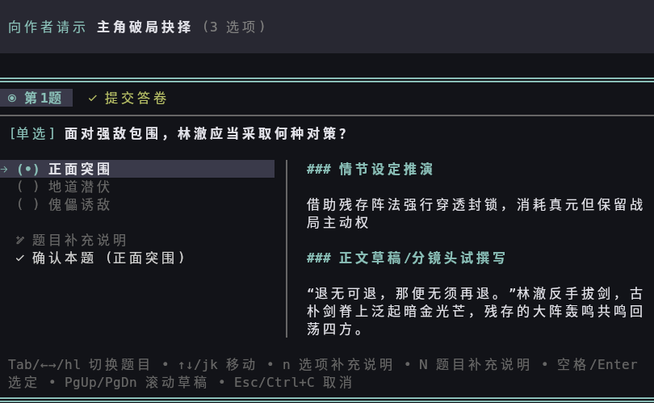

# pi-ask-author

[](https://www.npmjs.com/package/@sendevia/pi-ask-author)
[](https://opensource.org/licenses/MIT)

在 Pi 终端里，把影响故事走向的决定交回给你。

AI 陪你写小说时，遇到岔路口会弹出一张全屏问卷：每个选项附上剧情后果与正文草稿预览，你挑选、勾选、批注，AI 拿到你的决定后继续写作。



## 它解决的麻烦

协同写作最费神的环节，是决定接下来写什么。在对话框里来回讨论，既丢失上下文也难以比较。这个插件让你在一次询问里看清每条走向的代价，直接作出决定。

## 功能

**看得见后果再选择**
光标移到哪个选项，上方就展示该选项的剧情因果推演与 Markdown 正文草稿。草稿按小说语法高亮对话台词，预览区占满终端剩余高度，长内容用 `[` `]` 翻页。

**两级批注**
可以给整道题写补充说明，也可以给单个选项写批注。未勾选的选项同样能写批注，让 AI 参考你放弃的方向里还有哪些可取之处。

**单选与多选**
每道题可设为单选或多选，并限定最少勾选数、最多勾选数，或允许不作选择直接通过。

**一屏回答多个决策**
把相关联的问题放进同一张问卷，用顶部标签页切换。题目与选项还能设置条件，随你前面的选择逐步展开。

**边答边生成后续问题**
开启实时推演后，你每确认一道题，AI 会立刻接着写出后续题目与新选项。适合只想好开头、愿意边写边定方向的情形。

**终端里的完整界面**
全屏作答页、提交总览页、批注编辑页一应俱全，支持鼠标滚轮与点击。界面语言自动跟随系统，提供简体中文、英文、日文、韩文。

## 安装

```bash
# 从 npm 安装
pi install npm:@sendevia/pi-ask-author

# 或从 GitHub 安装
pi install git:github.com/sendevia/pi-ask-author
```

安装后每次启动 `pi` 自动加载。

不安装也能试用：

```bash
pi -e git:github.com/sendevia/pi-ask-author
```

## 使用

AI 判断需要你拍板时会自动弹出问卷，你作答后它接着写。

想主动触发，在提示词里说明即可，例如：

> 用 ask_author 问我想写哪种结局，每个选项附一段草稿。

输入 `/ask-author` 可以查看这个插件的用法提示。

## 快捷键

| 按键 | 作用 |
| :--- | :--- |
| `Tab` `Shift+Tab` / `←` `→` / `h` `l` | 在题目页与提交总览页之间切换 |
| `1`~`9` | 跳转到第 N 题 |
| `↑` `↓` / `k` `j` | 作答页移动光标；总览页上下滚动 |
| `Home` / `End` | 作答页跳到菜单首项或末项；总览页跳到顶部或底部 |
| `Space` | 作答页勾选或取消勾选当前选项；总览页向下滚动 |
| `Enter` / `Ctrl+S` | 作答页确认本题并前进；总览页提交答卷 |
| `n` / `e` | 编辑当前选项的专属批注；光标停在题目补充说明入口时编辑题目补充说明 |
| `N` | 编辑题目整体补充说明 |
| `x` / `Delete` | 清空当前选项的批注，其次清空题目补充说明 |
| `a` | 多选模式下全选或清空已选项 |
| `[` / `Alt+↑` | 作答页向上滚动预览区；总览页向上滚动 |
| `]` / `Alt+↓` | 作答页向下滚动预览区；总览页向下滚动 |
| `Esc` / `Ctrl+C` | 取消本次询问（编辑器中首次按下需再次确认丢弃修改） |

## 开源许可证

基于 [MIT License](LICENSE) 发布，欢迎反馈问题与提出改进建议。
