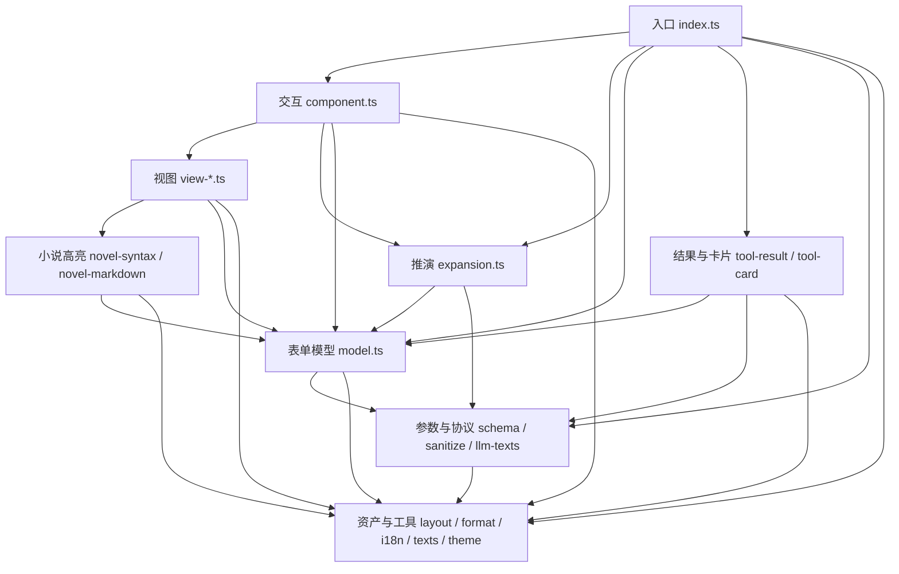

# pi-ask-author 架构

## 形态

单个 npm 包、单个 Pi 扩展。`src/index.ts` 是唯一入口，导出扩展工厂 `askAuthorExtension`，注册 `ask_author` 工具与 `/ask-author` 命令。构建时 `tsc` 产出类型声明，`esbuild` 打包 `dist/index.js`，`terser` 压缩；`@earendil-works/pi-coding-agent`、`@earendil-works/pi-tui` 与 `typebox` 保持外部引用，运行期不携带其他第三方代码。

## 分层

- **入口**：`index.ts` 只做守卫与分支编排，并装配推演执行器；不持有语义状态，不参与排版。
- **交互**：`component.ts` 持有键盘状态机、整屏帧缓存、在途推演的取消与 `dispose`；四个 `view-*` 模块只负责排版。
- **领域**：`model.ts` 是问卷语义状态的唯一持有者——归一化、显隐快照、作答状态、推演插入与撤回、答卷编译与封套文本。
- **协议**：`schema.ts` 声明入参，`sanitize.ts` 收敛不可信入参，`llm-texts.ts` 提供面向模型的英文协议文案，`expansion.ts` 组装推演请求并解析回复。
- **资产与工具**：`layout.ts`（几何、图标、上限）、`format.ts`（视口与文本工具）、`i18n.ts` 与 `texts.ts`（语言资源装载与合并）、`theme.ts`（主题类型）、`novel-syntax.ts` 与 `novel-markdown.ts`（小说语法高亮）。

## 模块依赖

依赖只从上层指向下层：视图不导入 `component.ts`，`tool-result.ts` 与 `tool-card.ts` 不导入 `index.ts`，`layout.ts` 与 `theme.ts` 不导入插件内任何模块。逐条的具体边见 AGENTS.md 第 2.2 节。

## 横向不变式

- 语义状态的修改只发生在键盘事件路径与模型方法内；`render` 及其调用的排版函数只读取状态。
- 语义状态每次变化推进 `revision`；组件据此清空整屏帧缓存、Tab 栏缓存与各视图缓存。焦点切换只失效整屏帧缓存，已解析的预览内容保留复用。
- 不可信输入经过两道处理：`prepareArguments` 的清洗收敛为白名单结构，`AskAuthorFormModel` 构建期再做归一化与默认值补全。
- 作者可见文案、图标字形、几何数值、题目与选项上限只在各自的单一出处声明，业务层读取使用。
- 渲染宽度一律经 `pi-tui` 的 `visibleWidth` / `truncateToWidth` / `wrapTextWithAnsi` 计算，不用字符串长度代替。
- 推演失败、回复不可解析或追加内容的条件非法时整批丢弃，已填写的作答保持不变。
- 组件的 `dispose` 幂等，结束路径释放计时器、`AbortSignal` 监听器与缓存容器。
- 非法状态就地抛出或返回结构化错误结果，捕获异常后静默继续属于禁止行为。

## 关键决策

- **推演在工具内部完成**：`ctx.ui.custom` 在作答期间独占终端界面，模型拿不到作者作答途中的控制权，后续题目只能在同一次工具调用内由扩展直接调用当前会话模型生成。推演调用的用量累加后挂在工具结果的 `usage` 字段回传宿主。
- **工具声明 `exposure: "model-only"`**：问卷是模型向作者提问的通道，嵌套调用会破坏独占界面；同时标注只读与封闭世界，供权限扩展判断。
- **交互式界面的串行执行**：`executionMode: "sequential"`，多个表单不会同时挂载。
- **不引入第三方依赖**：宿主的排版原语与 `typebox` 已覆盖需要，减少安装体积与版本冲突面。
- **小说语法借哨兵转换**：`novel-markdown.ts` 把台词与心理旁白转换为携带语义哨兵的行内代码，由定制 Markdown 主题完成着色，复用宿主 `Markdown` 解析器。
- **英文协议与本地化界面分离**：面向模型的描述、封套与推演提示词恒为英文并集中在 `llm-texts.ts`；作者界面文案取自 `lang/*.json`，规范语言为 `en_US`。

## 编码纪律

编码约束、强制规则与禁令以 AGENTS.md 为准；本图谱记录架构与边界，两处互相引用而不复制同一段内容。
